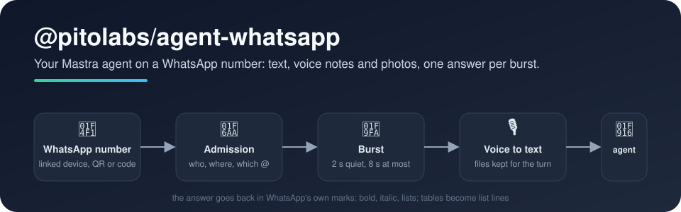

<p align="center">
  
</p>

<p align="center">
  <a href="https://www.npmjs.com/package/@pitolabs/agent-whatsapp"></a>
  <a href="https://github.com/pitolabs/agent-whatsapp/actions/workflows/ci.yml"></a>
  <a href="LICENSE"></a>
</p>

# 👋 Welcome to agent-whatsapp

Put **your Mastra agent on a WhatsApp number**. The number is a linked device (like WhatsApp Web), paired from a page
in your app; people write to it, send voice notes and photos, and the agent answers in WhatsApp's own formatting.
*"2 latas de tinta branca e um rolo"*, typed in three messages and a voice note, reaches the agent as one turn.

Built for [Mastra](https://mastra.ai) Channels on the Chat SDK and the
[`chat-adapter-baileys`](https://www.npmjs.com/package/chat-adapter-baileys) adapter. The burst queue
(`createBurstQueue`) has no framework dependency.

## ✨ What you get

- 📱 **A linked device per number**: `linkedDevice({ authDir, userName, logPrefix })` gives the Chat SDK adapter,
  its link state and the bot's own JID and LID; the session lives in a folder you choose.
- 🔗 **A pairing page**: `pairingRoutes(path, title, phone, link, middleware)` shows the QR, or a code for pairing by
  phone number, behind your own login check; the QR and the code never reach the logs.
- 🧺 **One turn per burst**: messages from one sender are batched (2 s of quiet, 8 s at most, closed early when
  someone else writes) and run one at a time per conversation.
- 🎙️ **Voice notes as text**: each audio goes to an OpenAI-compatible `/audio/transcriptions` endpoint and becomes
  `[Áudio transcrito] …` in the message the agent reads.
- 🚪 **Admission in your hands**: an `Admit` function decides per raw message and stamps the request context;
  `samePhone` compares Brazilian numbers with or without the ninth digit.
- ✍️ **WhatsApp formatting**: `WhatsAppConverter` turns the model's Markdown into WhatsApp marks (tables become list
  lines), and `WHATSAPP_FORMAT` tells the model what WhatsApp can show.
- 👥 **Groups by @ only**: `mentionsBot` reads native mentions (`contextInfo.mentionedJid`), which the Chat SDK alone
  never sees.

## 🪶 Light, cheap, yours

- 🪶 **Two runtime dependencies** (`pino`, `qrcode`); Mastra, Chat SDK, Baileys and the adapter are peers you already
  have. One entry point, plain ES modules.
- 🔐 **Private by default**: logs carry message ids, lengths and status codes, never message text, transcripts, QR
  codes or pairing codes. Speech-to-text goes only to the server you configure.
- 🧰 **One process**: the device connects from your app; no extra service besides your speech-to-text server.

## 🚀 Quick start

```bash
bun add @pitolabs/agent-whatsapp      # or: npm install @pitolabs/agent-whatsapp
```

```ts
import { Agent } from "@mastra/core/agent";
import { ApprovalGate } from "@pitolabs/agent-docs/mastra";
import { linkedDevice, samePhone, senderPhone, sttConfig, WHATSAPP_FORMAT, whatsappHandler } from "@pitolabs/agent-whatsapp";

const device = await linkedDevice({ authDir: "./whatsapp-auth", userName: "Clerk", logPrefix: "clerk" });
const staff = ["15550100100"];

const handler = whatsappHandler({
	log: "clerk",
	gate: new ApprovalGate(),
	stt: sttConfig({ url: process.env.STT_URL, token: process.env.STT_TOKEN }),
	admit: (raw) => {
		const phone = senderPhone(raw);
		const person = phone && staff.find((p) => samePhone(p, phone));
		if (!person || raw.key.remoteJid?.endsWith("@g.us")) return { admit: false, reason: "not staff" };
		return { admit: true, sender: person, stamp: (ctx) => ctx.set("clerkPerson", person) };
	},
});

export const clerk = new Agent({
	id: "clerk",
	name: "Clerk",
	model: "openai/gpt-4o-mini",
	instructions: `You help the shop's staff.\n\n${WHATSAPP_FORMAT}`,
	channels: {
		adapters: { whatsapp: { adapter: device.adapter, textFormat: "markdown", toolDisplay: "hidden" } },
		handlers: { onDirectMessage: handler, onMention: handler, onSubscribedMessage: handler },
		userName: "Clerk",
		// The pairing page learns the link state from this logger; it also logs a status heartbeat.
		chatOptions: { logger: device.link.chatLogger("clerk-chat") },
	},
});
```

Your app then initializes the channels and calls `device.connect()`, and mounts `pairingRoutes` behind its login.
The [guide](docs/guide.md) walks through it.

## 📚 Learn more

|Page|Answers|
|---|---|
|📘 [Guide](docs/guide.md)|How do I wire it in, pair the number, and run speech-to-text?|
|📖 [Reference](docs/reference.md)|What does each export accept and do?|
|🤝 [Contributing](CONTRIBUTING.md)|Setup, hooks, tests, releasing.|

## 🇧🇷 Language

The texts people see (the pairing page, the transcript markers, `WHATSAPP_FORMAT`) are in Brazilian Portuguese: the
package comes from agents that answer in it.

## 💜 Who made it

[Pito Labs](https://github.com/pitolabs), from the WhatsApp agents we run. MIT licensed; issues and pull requests
welcome.
